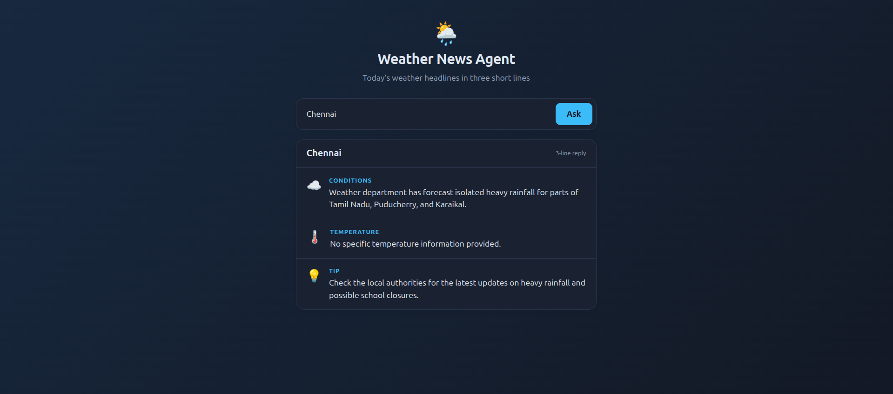

# Weather News Agent

An [AutoGen](https://microsoft.github.io/autogen/) agent that takes a city, searches the web for today's weather news with the free, keyless [DuckDuckGo](https://pypi.org/project/ddgs/) search package, and replies in **3 short lines**.




[Full-quality video](assets/screencast.mp4)

## How it works

1. You give the agent a city.
2. The model decides to call the `get_weather_news` tool. It picks the tool from the tool's docstring, which says it is for *today's weather news*, not general trivia.
3. The tool runs a DuckDuckGo news search for `"<city> weather forecast"` and returns the top 3 headlines.
4. Because `reflect_on_tool_use=True`, the model reads those results and writes the final reply: **Conditions**, **Temperature**, **Tip**.

With `reflect_on_tool_use=False`, the agent would print the raw tool output (the list of headlines) instead of a 3-line reply.

## Files

| File | Purpose |
| --- | --- |
| `weather_news.py` | The agent and its search tool. Run it directly for a terminal chat. |
| `server.py` | A small web UI on `http://localhost:8000` (standard library only). |
| `assets/` | The screenshot and screencast shown above. |

## Setup

```bash
python3 -m venv .venv
.venv/bin/pip install autogen-agentchat "autogen-ext[ollama]" ddgs
```

The agent uses a free local model through [Ollama](https://ollama.com):

```bash
ollama pull qwen2.5:1.5b
```

To use OpenAI instead, set `OPENAI_API_KEY` and replace the model client in `weather_news.py` with `OpenAIChatCompletionClient(model="gpt-4o-mini")`.

## Run

**Terminal.** This prints the tool call and the 3-line reply:

```bash
.venv/bin/python weather_news.py
```

**Web UI.** Start the server, then open <http://localhost:8000>, type a city and press **Ask**:

```bash
.venv/bin/python server.py
```

The UI shows only the 3-line reply. The tool call is visible in the terminal run above.

## Known limits

- The default `qwen2.5:1.5b` model is small. It sometimes drifts from the 3-line format or skips the tool call. A larger model fixes this.
- DuckDuckGo news results vary between runs and don't always include a temperature. The reply then says so.
- The web server handles one request at a time.
